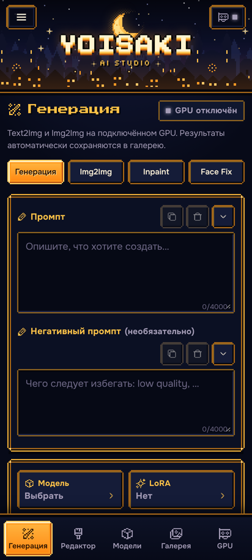
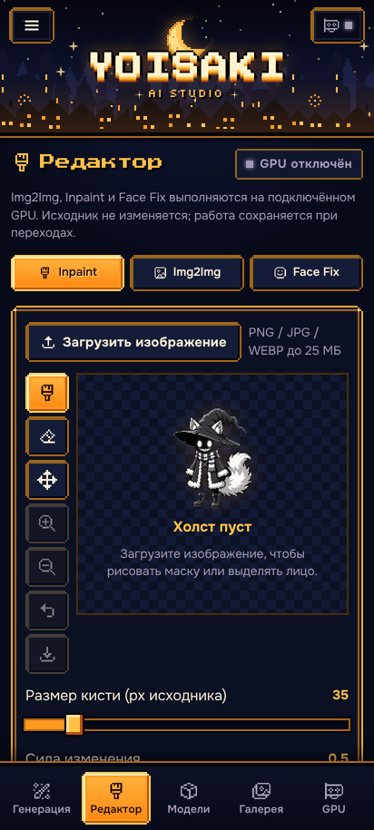
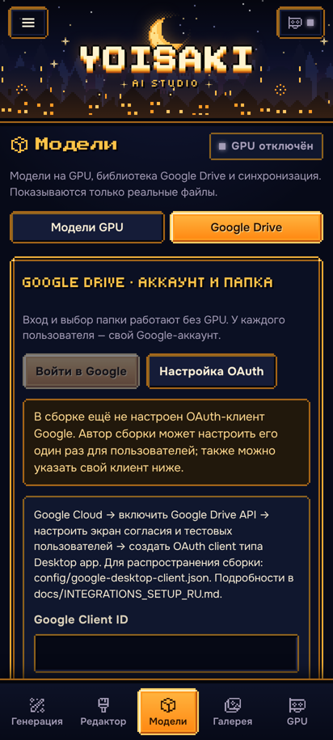
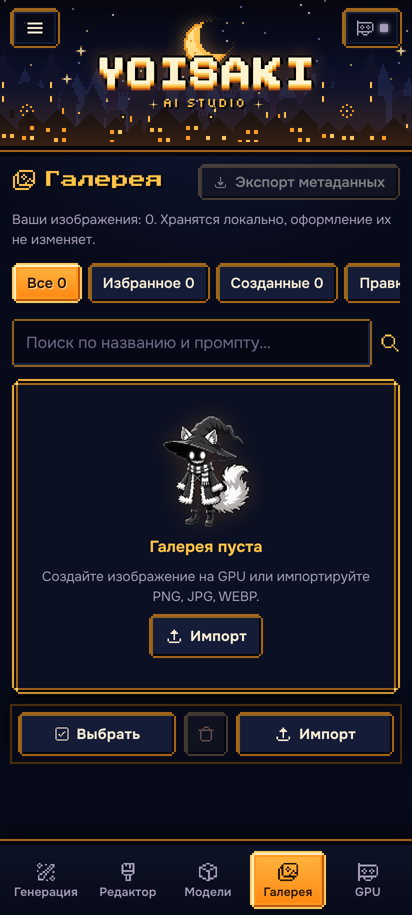
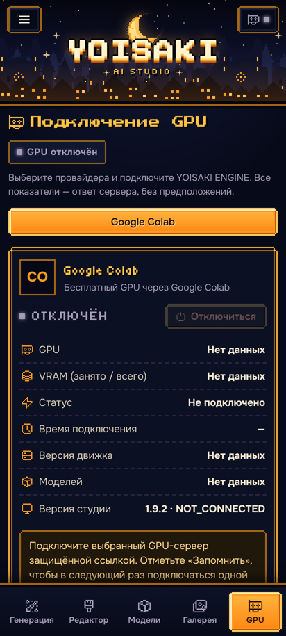

<p align="center">
  
</p>

<h1 align="center">YOISAKI AI STUDIO · v1.9.2 PIXEL FANTASY</h1>

<p align="center">
  <b>Пиксельная AI-мастерская на вашем Android-телефоне.</b><br>
  Генерация, редактор, модели и галерея — локально в Termux. Вычисления — на вашем Google Colab.
</p>

<p align="center">
  <a href="https://github.com/regmop4576-hash/YOISAKI-AI-STUDIO/releases/latest"></a>
  <a href="https://colab.research.google.com/github/regmop4576-hash/YOISAKI-AI-STUDIO/blob/main/colab/YOISAKI_ENGINE_V1.9.2_COLAB.ipynb"></a>
  <a href="#-видеоинструкция"></a>
</p>

<p align="center">
  <a href="README_EN.md">English version</a> ·
  <a href="docs/ru/QUICK_START.md">Быстрый старт</a> ·
  <a href="docs/ru/INSTALL_TERMUX.md">Установка в Termux</a> ·
  <a href="docs/ru/GOOGLE_COLAB.md">Google Colab</a> ·
  <a href="docs/ru/FAQ.md">FAQ</a>
</p>

---

## ✦ Что это такое

**YOISAKI AI STUDIO** — локальный интерфейс для работы с **вашими собственными** моделями генерации изображений
(SDXL / Illustrious checkpoint, LoRA, VAE).

Важно понимать с самого начала:

- Сайт работает **на вашем телефоне** (Termux + браузер) по адресу `http://127.0.0.1:3000`.
- Сайт **сам по себе не даёт видеокарту** и **не является нейросетью**. Он управляет генерацией.
- Тяжёлые вычисления выполняет **YOISAKI ENGINE** — блокнот Google Colab, который вы запускаете в своём аккаунте
  Google. Движок подключается к сайту по защищённой ссылке.
- Модели лежат **на вашем Google Drive**. В репозитории и в релизе моделей нет.
- Это **не облачный сервис** и не «бесплатная генерация навсегда»: доступ к GPU в бесплатном Colab ограничен
  по времени и не гарантирован.

```
 Телефон (Termux)                      Google Colab (ваш аккаунт)           Google Drive (ваш)
┌──────────────────────┐  ссылка+токен ┌──────────────────────────┐ чтение ┌─────────────────────┐
│ YOISAKI AI STUDIO    │ ────────────► │ YOISAKI ENGINE 1.8.1     │ ◄───── │ models/checkpoints  │
│ промпты, редактор,   │ ◄──────────── │ API 1.7.0 · GPU (T4)     │        │ models/loras        │
│ галерея, настройки   │  картинки     │ CPU Offload · RAM FIX    │        │ models/vae          │
└──────────────────────┘               └──────────────────────────┘        └─────────────────────┘
```

## ✦ Скриншоты (настоящий сайт v1.9.2)

| Генерация | Редактор | Модели | Галерея | GPU |
|:---:|:---:|:---:|:---:|:---:|
|  |  |  |  |  |

<sub>Снято с чистой установки из релизного ZIP, без подключённого GPU и без пользовательских данных.</sub>

## ✦ Возможности

- **Генерация:** Text2Img и Img2Img, выбор checkpoint, до 8 LoRA с весами 0–2, ширина/высота, шаги, CFG, Sampler,
  Scheduler, Seed, количество изображений; ControlNet (OpenPose / SDPose-OOD, Depth, Canny); Regional Control.
- **Редактор:** Inpaint (кисть, ластик, маска в полном разрешении), Img2Img, **Smart Face Fix** — лицо находится
  автоматически, есть ручное выделение и сравнение «До / После».
- **Модели:** каталог моделей с GPU, обновление списка, проверка совместимости; библиотека Google Drive.
- **Галерея:** локальная (в браузере телефона), фильтры, избранное, метаданные и промпт, «Открыть в редакторе».
- **Pixel Fantasy:** пиксельная дизайн-система, русский интерфейс по умолчанию, английский — в настройках,
  установка на главный экран (PWA).
- **Надёжная установка:** проверка целостности всех файлов (SHA-256), готовая production-сборка внутри ZIP,
  обновление с резервной копией кода и данных и автоматическим откатом.

## ✦ Установка одной командой

Нужно: Android 7+ и [Termux](docs/ru/INSTALL_TERMUX.md#1-установите-termux) из **F-Droid или GitHub** (не из Google Play).
Откройте Termux, вставьте команду и нажмите ввод:

```bash
pkg install -y curl && curl -fsSL https://raw.githubusercontent.com/regmop4576-hash/YOISAKI-AI-STUDIO/main/install-termux.sh | bash
```

Установщик сам поставит Node.js LTS, unzip и curl, возьмёт последний стабильный релиз с GitHub, скачает архив,
сверит SHA-256 с `SHA256SUMS.txt` релиза, запустит штатную проверку целостности всех файлов, установит и запустит
сайт. В конце он покажет адрес:

**http://127.0.0.1:3000** — откройте его в браузере телефона.

| | |
|---|---|
| `yoisaki start` / `yoisaki stop` | запустить / остановить сайт |
| `yoisaki update` | обновиться (настройки и галерея сохраняются, неудачное обновление откатывается) |
| `yoisaki status` | диагностика |

Ни ZIP вручную, ни `termux-setup-storage` не нужны. Повторный запуск команды безопасен: если стоит последняя
версия, ничего не скачивается. Подробно, с тем, что вы увидите на каждом шаге:
**[docs/ru/INSTALL_TERMUX.md](docs/ru/INSTALL_TERMUX.md)** · установщик: [`install-termux.sh`](install-termux.sh).

## ✦ Подключение Google Colab

1. Положите модели на Google Drive: `MyDrive/YOISAKI_AI_STUDIO/models/checkpoints`, `…/loras`, `…/vae`.
2. Откройте блокнот <a href="https://colab.research.google.com/github/regmop4576-hash/YOISAKI-AI-STUDIO/blob/main/colab/YOISAKI_ENGINE_V1.9.2_COLAB.ipynb">YOISAKI ENGINE v1.9.2 в Colab</a>,
   выберите **T4 GPU**, запустите «🚀 1. ПОДГОТОВИТЬ ПАНЕЛЬ» и нажмите «ЗАПУСТИТЬ ДВИЖОК».
3. Скопируйте защищённую ссылку **целиком** (с `#token=…`).
4. На сайте: **GPU → Google Colab → «Вставить ссылку из буфера» → «Подключиться»**.
5. **Модели → Модели GPU → «Обновить модели»**, выберите модель на странице «Генерация» — и «ГЕНЕРИРОВАТЬ».

На сайте будет «Версия движка 1.8.1 · API 1.7.0» и «Версия студии 1.9.2 · COMPATIBLE» — так и должно быть.
Подробно: **[docs/ru/GOOGLE_COLAB.md](docs/ru/GOOGLE_COLAB.md)**.

## ✦ Видеоинструкция

<a href="https://github.com/regmop4576-hash/YOISAKI-AI-STUDIO/releases/download/v1.9.2/YOISAKI_PIXEL_FANTASY_FULL_TUTORIAL.mp4">
  
</a>

**[▶ Смотреть видеоинструкцию](https://github.com/regmop4576-hash/YOISAKI-AI-STUDIO/releases/download/v1.9.2/YOISAKI_PIXEL_FANTASY_FULL_TUTORIAL.mp4)**
— 10 минут, русская озвучка, 1080p (MP4, 84 МБ, файл релиза v1.9.2).
История проекта, запуск Colab на T4, Google Drive, подключение движка, генерация, редактор, галерея и честно
об ограничениях. В части роликов интерфейс настоящий, а движок тестовый — это подписано в кадре.

## ✦ Документация

| Тема | Русский | English |
|---|---|---|
| Быстрый старт | [QUICK_START](docs/ru/QUICK_START.md) | [QUICK_START](docs/en/QUICK_START.md) |
| Установка в Termux | [INSTALL_TERMUX](docs/ru/INSTALL_TERMUX.md) | [INSTALL_TERMUX](docs/en/INSTALL_TERMUX.md) |
| Google Colab | [GOOGLE_COLAB](docs/ru/GOOGLE_COLAB.md) | [GOOGLE_COLAB](docs/en/GOOGLE_COLAB.md) |
| Модели и LoRA | [MODELS_AND_LORA](docs/ru/MODELS_AND_LORA.md) | [MODELS_AND_LORA](docs/en/MODELS_AND_LORA.md) |
| Редактор | [EDITOR_GUIDE](docs/ru/EDITOR_GUIDE.md) | [EDITOR_GUIDE](docs/en/EDITOR_GUIDE.md) |
| Если что-то не работает | [TROUBLESHOOTING](docs/ru/TROUBLESHOOTING.md) | [TROUBLESHOOTING](docs/en/TROUBLESHOOTING.md) |
| Вопросы и ответы | [FAQ](docs/ru/FAQ.md) | [FAQ](docs/en/FAQ.md) |

Технические отчёты версий (`YOISAKI_V*_REPORT*.md`, `CHANGELOG_RU.md`) лежат в корне репозитория, история
изменений кратко — в [CHANGELOG.md](CHANGELOG.md).

## ✦ Требования

| Компонент | Требование |
|---|---|
| Телефон | Android 7+ с Termux из F-Droid или GitHub (не из Google Play) |
| Node.js | 22–26 (рекомендуется 24 LTS) — проверяется `install.sh` |
| Браузер | Любой современный Chromium-браузер или Firefox на Android |
| Вычисления | Google Colab с GPU (проверялось под T4), YOISAKI ENGINE 1.7.0 / 1.7.6 / 1.8.0 / 1.8.1, API 1.7.0 |
| Модели | Ваши SDXL / Illustrious `.safetensors` на Google Drive |

## ✦ Честно об ограничениях

- Реальная генерация на Tesla T4 с полноразмерным Illustrious в среде разработки релиза **не проверялась**;
  автоматические тесты используют синтетический GPU и не подтверждают качество или стабильность на T4.
- Установщик и установка в настоящем Termux на реальном Android-устройстве **не проверялись**; установщик прошёл
  35 автоматических проверок в чистой имитации Termux (`tests/installer/run.sh`).
- Бесплатный Colab может отключить сессию, отказать в GPU или ограничить время работы.
- CloudCompute и Docker-развёртывание есть в коде, но скрыты по умолчанию и на реальном GPU не испытаны.

## ✦ Для разработчиков

Репозиторий содержит исходники без готовой сборки `dist/` (она собирается в релизный ZIP). Поэтому для телефона
используйте **файл релиза**, а не «Source code» или `git clone`: в клоне `verify-package.mjs` сообщит об
отсутствии файлов `dist/`. Для разработки: Node.js 22–26, `npm ci`, `npm run build`, `npm run typecheck`,
`npm test` (Node-тесты), `python -m pytest tests` (тесты движка, нужны зависимости из `engine/requirements.txt`).

## ✦ Безопасность

Ссылка движка содержит секретный токен — **не публикуйте её** и не показывайте на скриншотах. Сайт слушает только
`127.0.0.1`. Галерея и настройки хранятся на телефоне. Подробнее — [SECURITY.md](SECURITY.md).

## ✦ Лицензия

Код проекта — [Apache License 2.0](LICENSE). Шрифты Tiny5, Press Start 2P, Onest (SIL OFL 1.1), иконки
Pixelarticons (MIT) и детекторы лиц lbpcascade_animeface и YuNet (MIT) распространяются под собственными
лицензиями — см. [NOTICE](NOTICE), `public/licenses/` и `engine/inference/face_models/LICENSES.md`.
Apache-2.0 не даёт прав на название и логотип YOISAKI (раздел 6 лицензии).
Модели, которые вы подключаете, подчиняются лицензиям их авторов.
