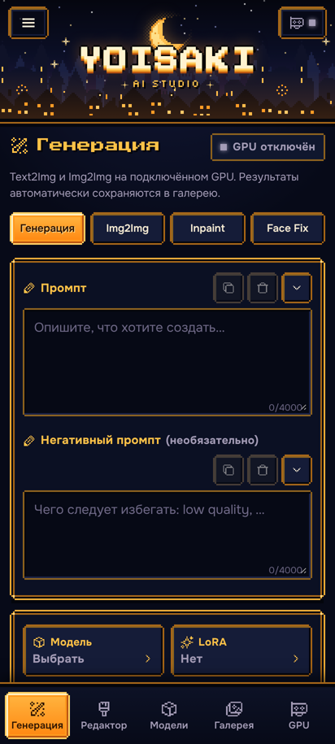
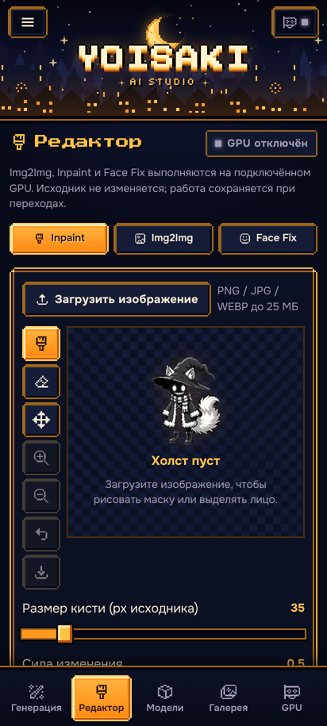
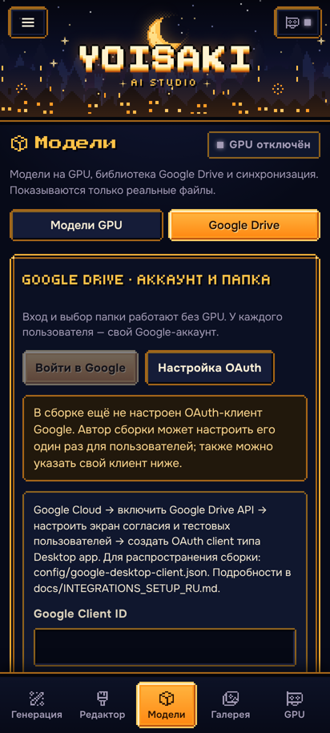
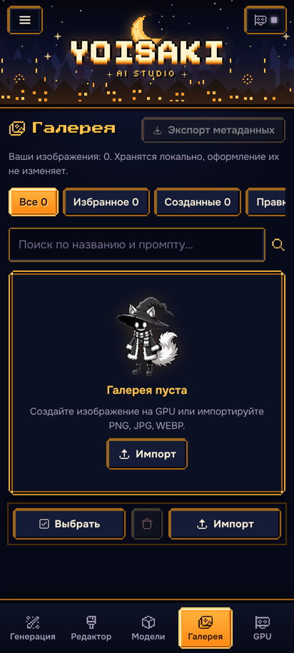
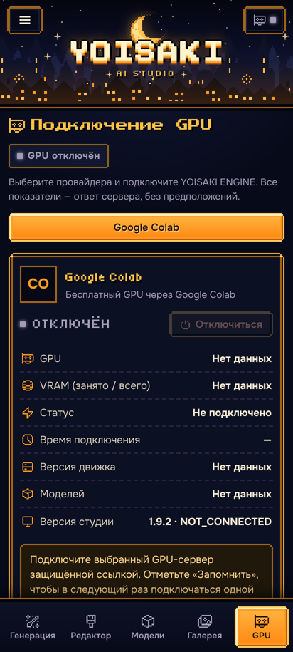

<p align="center">
  
</p>

<h1 align="center">YOISAKI AI STUDIO · v1.9.2 PIXEL FANTASY</h1>

<p align="center">
  <b>A pixel-art AI image workshop that runs on your Android phone.</b><br>
  Generator, editor, models and gallery run locally in Termux. The heavy lifting runs in your own Google Colab.
</p>

<p align="center">
  <a href="https://github.com/regmop4576-hash/YOISAKI-AI-STUDIO/releases/latest"></a>
  <a href="https://colab.research.google.com/github/regmop4576-hash/YOISAKI-AI-STUDIO/blob/main/colab/YOISAKI_ENGINE_V1.9.2_COLAB.ipynb"></a>
</p>

<p align="center"><a href="README.md">Русская версия (основная)</a></p>

> The user interface is Russian by default; English can be selected in **Settings**. The video tutorial is in
> Russian.

## What it is — and what it is not

**YOISAKI AI STUDIO** is a local interface for **your own** image-generation models (SDXL / Illustrious
checkpoints, LoRA, VAE).

- The site runs **on your phone** (Termux + browser) at `http://127.0.0.1:3000`.
- The site **does not provide a GPU** and **is not a generative model**. It orchestrates generation.
- Compute is done by **YOISAKI ENGINE**, a Google Colab notebook you run in your own Google account. It connects
  to the site through a secure tunnel link.
- Models live on **your Google Drive**. No models are included in this repository or release.
- It is **not a hosted cloud service** and not "free generation forever": GPU access on Colab Free is time-limited
  and not guaranteed.

## Screenshots (real v1.9.2 site)

| Generate | Editor | Models | Gallery | GPU |
|:---:|:---:|:---:|:---:|:---:|
|  |  |  |  |  |

## Features

- **Generate:** Text2Img and Img2Img, checkpoint selection, up to 8 LoRA with weights 0–2, size, steps, CFG,
  sampler, scheduler, seed, batch; ControlNet (OpenPose / SDPose-OOD, Depth, Canny); Regional Control.
- **Editor:** Inpaint (brush, eraser, full-resolution mask), Img2Img, **Smart Face Fix** with automatic face
  detection, manual selection and Before / After comparison.
- **Models:** model catalogue reported by the GPU, refresh, compatibility marks; Google Drive library.
- **Gallery:** local (in the phone browser), filters, favourites, metadata and prompt, "Open in editor".
- **Robust install:** SHA-256 integrity check for every file, prebuilt production bundle inside the ZIP, updates
  with code and data backups and automatic rollback.

## One-command install

Requirements: Android 7+ and Termux from **F-Droid or GitHub** (not Google Play). In Termux, paste:

```bash
pkg install -y curl && curl -fsSL https://raw.githubusercontent.com/regmop4576-hash/YOISAKI-AI-STUDIO/main/install-termux.sh | bash
```

The installer sets up Node.js LTS, unzip and curl, takes the latest stable GitHub Release, downloads the ZIP,
verifies its SHA-256 against the release's `SHA256SUMS.txt`, runs the project's per-file integrity check, installs
and starts the site, and prints **http://127.0.0.1:3000**. Then use `yoisaki start | stop | restart | status |
update | open`. Re-running is safe and downloads nothing when the latest version is installed; updates keep
settings and the gallery and roll back automatically on failure.
Details: **[docs/en/INSTALL_TERMUX.md](docs/en/INSTALL_TERMUX.md)** · installer: [`install-termux.sh`](install-termux.sh).

## Connect Google Colab

1. Put your models on Google Drive: `MyDrive/YOISAKI_AI_STUDIO/models/checkpoints`, `…/loras`, `…/vae`.
2. Open the [YOISAKI ENGINE v1.9.2 notebook in Colab](https://colab.research.google.com/github/regmop4576-hash/YOISAKI-AI-STUDIO/blob/main/colab/YOISAKI_ENGINE_V1.9.2_COLAB.ipynb),
   select **T4 GPU**, run "🚀 1. ПОДГОТОВИТЬ ПАНЕЛЬ" (prepare panel) and press "🚀 ЗАПУСТИТЬ ДВИЖОК" (start engine).
3. Copy the secure link **in full**, including `#token=…`.
4. On the site: **GPU → Google Colab → paste link → Connect**.
5. **Models → GPU models → Refresh**, pick a model on the Generate page and press **GENERATE**.

The site will show "Engine 1.8.1 · API 1.7.0" and "Studio 1.9.2 · COMPATIBLE" — this is expected.
Details: **[docs/en/GOOGLE_COLAB.md](docs/en/GOOGLE_COLAB.md)**.

## Video tutorial (Russian)

<a href="https://github.com/regmop4576-hash/YOISAKI-AI-STUDIO/releases/download/v1.9.2/YOISAKI_PIXEL_FANTASY_FULL_TUTORIAL.mp4">
  
</a>

**[▶ Watch the video tutorial](https://github.com/regmop4576-hash/YOISAKI-AI-STUDIO/releases/download/v1.9.2/YOISAKI_PIXEL_FANTASY_FULL_TUTORIAL.mp4)**
— 10 min, Russian voice-over, 1080p, MP4 (84 MB), attached to release v1.9.2.

## Documentation

[Quick start](docs/en/QUICK_START.md) · [Termux install](docs/en/INSTALL_TERMUX.md) ·
[Google Colab](docs/en/GOOGLE_COLAB.md) · [Models & LoRA](docs/en/MODELS_AND_LORA.md) ·
[Editor](docs/en/EDITOR_GUIDE.md) · [Troubleshooting](docs/en/TROUBLESHOOTING.md) · [FAQ](docs/en/FAQ.md) ·
[Changelog](CHANGELOG.md) · [Security](SECURITY.md)

## Requirements

| Component | Requirement |
|---|---|
| Phone | Android 7+ with Termux from F-Droid or GitHub |
| Node.js | 22–26 (24 LTS recommended), checked by `install.sh` |
| Compute | Google Colab with GPU (designed for T4); YOISAKI ENGINE 1.7.0 / 1.7.6 / 1.8.0 / 1.8.1, API 1.7.0 |
| Models | Your own SDXL / Illustrious `.safetensors` on Google Drive |

## Known limitations

- Real generation on a Tesla T4 with a full-size Illustrious model was **not** verified in the release
  environment; automated tests use a synthetic GPU.
- The installer and installation in real Termux on a physical Android device were **not** verified; the
  installer passed 35 automated checks in a clean simulated Termux (`tests/installer/run.sh`).
- Colab Free may disconnect, deny a GPU, or limit session time.
- CloudCompute and Docker deployment exist in the code but are hidden by default and untested on real GPUs.

## For developers

The repository holds sources without the prebuilt `dist/` (it is shipped inside the release ZIP), so phones
should use the **release asset**, not "Source code" or `git clone`. Development: Node.js 22–26, `npm ci`,
`npm run build`, `npm run typecheck`, `npm test`, and `python -m pytest tests` for the engine (requires
`engine/requirements.txt`).

## Security

The engine link contains a secret token — **never publish it** or show it in screenshots. The site listens on
`127.0.0.1` only. See [SECURITY.md](SECURITY.md).

## License

Project code: [Apache License 2.0](LICENSE). Fonts Tiny5, Press Start 2P, Onest (SIL OFL 1.1), Pixelarticons
icons (MIT) and the lbpcascade_animeface and YuNet face detectors (MIT) keep their own licenses — see
[NOTICE](NOTICE). Apache-2.0 grants no rights to the YOISAKI name or logo (section 6). Models you connect are
governed by their authors' licenses.
